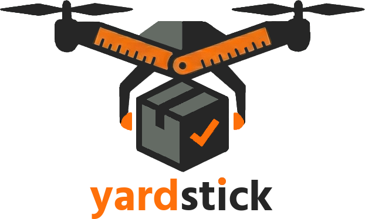

<p align="center">
  <picture>
    <source media="(prefers-color-scheme: dark)" srcset="assets/branding/logo-dark.png">
    
  </picture>
</p>

# Yardstick Development Studio

A desktop IDE, written in Rust with [egui](https://github.com/emilk/egui), for building
[Yardstick](https://github.com/jeffpearson1/Yardstick) recipes. It walks you through
**designing** a recipe, **testing** it with the recipe harness, **creating or fixing it
agentically** with the repo's `yardstick-recipes` skill, and **publishing** it as a pull
request.

The Studio never writes to a production Yardstick folder and never runs the harness
there. You work in a development clone and publish finished recipes as pull requests;
production pulls them once they are merged.

## Feature tour

| View | What it does |
|------|--------------|
| **Home** | A launcher: **Continue** a Recipe Builder list, **Import requests** from a file or pasted text, **New recipe**, **Edit a recipe** (search by id or name) and **Update several recipes**. Below it, the workspace status (production, development or unconfigured) with the clone's branch, how far behind it is, and *Fetch* / *Pull* / *Sync icons & overrides*, and a form that clones a development workspace from GitHub. |
| **Recipe Library** | Library of all shipped and `Recipes\Development` recipes, with filters, location and status badges, *New recipe*, *Copy to Development*, *Missing icons*, and *Update several…*. Clicking a recipe or *Open in Builder* adds it to the unified Recipe Builder working list and opens its Design/YAML/Test/Icon/Agent workspace there. |
| **Recipe Library → Design** | Form-based editor whose field catalogue mirrors Yardstick's schema (`Test-RecipeSchema`) and the skill's guidance. Fields are grouped into steps, script fields get a highlighted PowerShell editor with optional line numbers, and it lints as you type. A field whose variable a download script assigns is not marked required; if the YAML leaves it blank it is shown read-only as *set by preDownloadScript* (or whichever script sets it). Saving keeps key order and writes scripts as literal blocks. It warns before dropping YAML comments; use the YAML tab to keep them. |
| **Recipe Library → YAML** | Raw YAML with syntax highlighting and optional line numbers, kept in sync with Design. |
| **Recipe Library → Test** | Runs the harness steps: Lint, Schema, Lab (download/package) and Install test (dry run or live). **Run all checks** runs all six steps in order, stops on failure, and pauses for explicit consent before the live install test. **Run safe checks** chains Lint, Schema and DryRun without installing anything. With *Tenant validation* switched on in Settings, a separate **Tenant** card can run the recipe through Yardstick on your own Intune tenant as a test app named `YDS TEST - <name>` (see [Tenant validation](#tenant-validation-optional)). |
| **Recipe Library → Icon** | The icon finder, which replaces Yardstick's `Get-YardstickIcon.ps1`, filled in for the open recipe. It shows the recipe's current icon, and searches the web by itself only when there is no usable one. It searches installer resources (EXE/MSI), Wikidata/Commons, Chocolatey, the vendor site (manifest, touch icon, favicon) and image search in parallel, scores each result for relevance and merges duplicates. Preview on checker/dark/light backgrounds, clean it up (background removal, trim, square, margin), save it to `Icons\` and set `iconFile`. Also opens for a request item, from the library's *Missing icons*, or with `--icons "<app>"`. |
| **Recipe Builder → Agent** | Runs the `yardstick-recipes` skill on the open recipe through GitHub Copilot CLI, Claude Code or OpenAI Codex: Fix, Review, Update or Freeform. Fix and Update can **Test and repair automatically**: Studio runs every harness stage and returns recipe failures to the agent, up to five test attempts by default. Live install/uninstall checks require explicit run consent. Review is read-only. Every run is also kept in **Recipe Builder** as a one-item request (*fix app*, *review app*, …) with its status and test results, and *Run agent on this* there repeats the same task; the request you have open in Recipe Builder is not replaced. |
| **Recipe Builder** | A persistent working list unifies individual recipes, existing Library recipes and imported batches. Its left pane adds existing recipes, opens the inline new-recipe form, imports a file or pastes text; entries can be selected, removed, or cleared after confirmation. Removing the recipe open in the editor also closes its editor; unsaved work offers **Save and remove**, **Discard edits and remove**, **Keep in editor**, or cancel. The batch overview can **Complete all remaining**, **Complete selected**, or **Complete this recipe**. A running batch can pause after its active recipe. Requests sent to a plugin remain **in plugin** rather than appearing done; running, attention, approval and completion states roll back into the list, and **Open in…** / **Back to Recipe Builder** return to the exact linked work. Opening an existing recipe keeps the list and progress visible while exposing **Design**, **YAML**, **Test**, **Icon**, and **Agent**; *Batch overview* returns to the remaining work. **Save**, **Save as…** and **Load…** preserve lists under `%APPDATA%\YardstickStudio\batches`. Opening another list offers to append it, save and replace, replace without saving, or cancel. Imported formats include ServiceNow/JSON, CSV/TSV, Excel `xlsx/xls/ods`, YAML, text/Markdown/email, HTML and Word `docx`; quick scan and optional agent extraction find the software, version, vendor URL and ticket. One consent dialog covers a run's live tests, and system-context tests share one UAC prompt per run. |
| **History** | Browses `Artifacts\RecipeHarness\_install-tests`, parsing `summary.json` into verdicts and phase tables. It opens on the open recipe's newest run. Above the runs, **Agent credits by model** charts the average AI credits an app has cost with each model (every run on it counted together), with runs, per-run and total figures in a table. |
| **Publish** | Each selected development recipe becomes a pull request: the Studio uses a `studio/<id>` branch in a temporary worktree (your checkout is untouched), commits the recipe to its shipped path together with its test evidence (`Tests/RecipeEvidence/<id>.json`), and pushes it. If that recipe already has an open pull request, the new commit is appended to its branch and the pull request is updated; otherwise the Studio opens one with `gh`, or offers GitHub's compare page when `gh` is unavailable. The integrated monitor refreshes open Studio pull requests, CI/CD checks, reviews, and comments from people or Copilot. It asks before opening anything in the browser. The recipe's icon is copied to the shared icon folder (`SharedIcons`), not into git. Production pulls merged changes itself. Recipes without a passing live test of their current contents get a dialog listing the recorded checks before you can *Open anyway*; their evidence says they are not validated, so the check fails until they are tested or a maintainer labels the pull request `evidence-waived`. |
| **Setup** | The first-run wizard: pick or clone a development workspace, check the tools (PowerShell 7, git, gh, an agent CLI) with links to install what is missing, then Yardstick's development-only setup. It reads what is already in place with `Install-Yardstick.ps1 -Status`, pre-fills the answers (optional PowerShell modules, allowing scripts for your account, shared icon and recipe override folders), and applies them with a non-interactive `Install-Yardstick.ps1 -DevelopmentOnly` run, showing each step's result. It opens on first run, after cloning, from Home's *Set up this clone…*, and from Settings. Needs a Yardstick clone that includes jeffpearson1/Yardstick#36; older clones fall back to running the installer in a console. |
| **Agent options** | Wherever the agent picker appears (Settings, a recipe's Agent tab, Recipe Builder) it offers **Multi-agent (coordinator)**: a coordinating agent splits the work across parallel subagents and writes the recipe itself (Copilot CLI `--fleet`; Claude Code's subagents), at a higher credit cost. **Allow the agent to download and inspect installers** is the user's explicit approval for headless runs: it lifts Copilot CLI's path checks for the run (and, for Codex, its sandbox: commands inside it cannot make HTTPS requests, so this is the only way it can download) and tells the agent the approval was given, while installing software and touching production stay off limits. Codex has no subagents here, so **Multi-agent** is off for it. Each Copilot CLI run's AI credits appear in its log and the console's job list, per app in the Recipe Builder table, and as a per-app average next to the model. |
| **Plugins** | Each installed plugin adds its own tab after Publish. A plugin is a zip of a `plugin.yaml` manifest, PowerShell steps and agent instructions, installed from a file or from the Studio's GitHub releases under *Settings → Plugins*, which also checks for updates (at startup and on demand). Installing shows the publisher, the package's SHA-256 and what every step can do; steps that install software or change the tenant run only after you approve the exact file they act on. Plugins declare Studio-owned `hostActions` for standard new/import/refresh, work-folder and global-settings controls, plus `host.recipe-builder` and `host.plugin-workitem` integrations instead of recreating those workflows. A plugin's tab lists its work items with a pipeline of steps and agent tasks, or searches an outside system and acts on the chosen row. Plugins can opt safe stages into **Run safe stages**, which advances the pipeline until work fails, needs a manual prerequisite, reaches a product-routing or linked Recipe Builder boundary, or reaches confirmation, local-install, or tenant-write consent. A routable table can send individual rows into Recipe Builder; products retained by the plugin can use linked Recipe Builder items for shared research, authoring, checks and repair, with checked recipes synchronized back before the plugin continues. Run state survives restart; an active stage is marked **Interrupted**, completed output is preserved, and the run can continue from that boundary. Home surfaces plugin work waiting for attention, and *History → Plugin work* filters every active, waiting, interrupted and completed item across installed plugins with a direct link back to the exact work item. See [Plugins](#plugins). |
| **Settings** | Updates, production and trusted development folders, the optional **Tenant validation** card (off by default: the tenant this clone may use, test groups, what happens to a test app afterwards, *Connect this clone to Intune…* and a read-only *Check connection*), the agent CLI and model (models are read from the CLI), PowerShell, the tool check (pwsh, git, gh, agent CLIs; *Re-check* reloads `PATH`), and appearance. Changes save as you make them. |
| **Help** | The skill and its reference docs, rendered as Markdown. |

A recipe is **complete** when a live install test passed with exactly its current contents:
the Studio records the recipe's hash in `Artifacts\RecipeHarness\_studio\validated.json`
when a live test passes, and shows *Complete · not published* until the recipe changes
(then *Changed since validation*). When a newer Studio is released, a banner above every
page offers it until you open it or choose *Later*.

See [docs/DESIGN.md](docs/DESIGN.md) for the architecture and the safety model.

## Prerequisites

- Windows 10/11 and PowerShell 7 (`pwsh`). Windows PowerShell 5.1 is used as a fallback.
- Rust from [rustup](https://rustup.rs). Either host toolchain works:
  - **x86_64-pc-windows-msvc**: needs the Visual Studio C++ build tools.
  - **x86_64-pc-windows-gnu**: no Visual Studio needed, but it does need MinGW-w64 binutils:
    `winget install BrechtSanders.WinLibs.POSIX.MSVCRT --scope user`.
    `build.ps1` finds it automatically and sets `-C dlltool=`.
- A GPU with DirectX 12 or Vulkan, or the WARP software rasteriser. Rendering uses
  `wgpu`, so it works on VMs and RDP sessions that lack OpenGL 2.
- For the agent, GitHub Copilot CLI (`copilot`), Claude Code (`claude`) or OpenAI Codex (`codex`).
  The Studio also looks in their usual install folders (for Codex, including the folder the Codex
  desktop app unpacks its CLI to) and re-reads `PATH`, so one installed while it is open is found.
  Setup can install a missing one with winget and check that it is signed in.
- Optional: the GitHub CLI (`gh`), to open pull requests directly from Publish.

## Tenant validation (optional)

Off by default. The live install test proves a recipe on this PC, but only a run against a tenant shows how
Intune treats the upload, detection rules and assignments. When you want that before publishing:

1. **Settings → Tenant validation:** switch it on, enter the tenant id (and optionally its name), and name the test
   group(s). Choose what happens afterwards: deploy to the test group and leave the app, upload it unassigned and
   leave it, or remove it (with an option to be asked first).
2. **Connect this clone to Intune…** runs Yardstick's installer in a console and lists the clone under Trusted
   development folders. Answer **No** when it asks about a scheduled task. *Check connection* then signs in
   read-only and reports anything that would stop a run.
3. On a development recipe's **Test** tab, **Run on tenant…** shows exactly what will happen and needs your
   confirmation each time.

The app is created as `YDS TEST - <name>`, so it cannot change a real app's versions or assignments. Studio
temporarily adds an entry for the recipe to `Local\recipeOverrides.yaml`, forces the test groups, and puts the file
back afterwards (even after a crash). A test app can be removed from the result card; only the app a run created
can be removed. The result is shown on the Test tab, in the recipe's header and in the Publish dialog, for your
information. Publishing never requires it. A clone that is connected must have `syncSharedContent` off and no
scheduled task running Yardstick from it.

## Plugins

Plugins live in `%APPDATA%\YardstickStudio\plugins\<id>\` and are managed in *Settings → Plugins*:
**Install from file…** takes a plugin zip, **Install…** next to *Available* downloads one from the Studio's
releases, and **Update…** appears beside an installed plugin when a newer release exists. Every install and
update shows a trust prompt first; the downloaded zip must match the SHA-256 GitHub publishes for it and
must hold the plugin and version the release names.

This repository ships two plugins, each with its own README:

- **One-Off Packager** (`plugins\oneoff-packager`): batch extraction can route licensed, supplied-media and genuinely one-time requests here. When triage finds several products, Studio pauses so each reusable app can leave as an independent Recipe Builder item while the one-off products remain in this ticket. After inventory, those remaining products receive linked Recipe Builder work for research, authoring, safe checks and repair. Checked recipes and icons synchronize back, **Run safe stages** resumes preparation and packaging, and Studio pauses for your approval before anything is installed or changed in Intune.
- **SCCM App Migration** (`plugins\sccm-migration`): browses a Configuration Manager site's applications (read-only,
  over CIM), works out what an Intune app would need, copies the content, and hands the application to the One-Off
  Packager or to the New recipe dialog.

To package and test the plugins in this repository (`plugins\<id>\`):

```powershell
.\build.ps1 -Task plugins        # target\plugins\<id>-<version>.zip and .sha256
.\build.ps1 -Task plugin-test    # Pester 5 tests under plugins\*\tests
```

To publish one, bump `version` in its `plugin.yaml` in its own commit, build, then tag and release it.
The tag is `plugin-<id>-v<version>` and the release carries `<id>-<version>.zip`; use `--latest=false` so the
Studio's own update check, which reads the latest release and expects an MSI, is not thrown off:

```powershell
gh release create plugin-<id>-v<version> target\plugins\<id>-<version>.zip --latest=false --title "<name> <version>" --notes "..."
```

Build releases with one PowerShell: zlib output differs between Windows PowerShell 5.1 and PowerShell 7, so the
same folder gives the same bytes only on the same host.

## Build and run

`cargo` doesn't need to be on `PATH`, because `build.ps1` adds `%USERPROFILE%\.cargo\bin`:

```powershell
.\build.ps1                 # release build -> target\release\yardstick-studio.exe
.\build.ps1 -Task run       # debug build and launch
.\build.ps1 -Task test      # unit tests (headless engine + GUI helpers)
.\build.ps1 -Task clippy    # lint with -D warnings
.\build.ps1 -Task installer # release build + MSI (see Installer below)
.\build.ps1 -Task build -Debug
```

Command-line shortcuts:

```powershell
yardstick-studio.exe "Exported ticket list.json"   # open a request list in Batch mode
yardstick-studio.exe --batch .\requests.xlsx       # same thing, explicitly
yardstick-studio.exe --icons "Notepad++"           # open the icon finder and search
```

The live integration tests are ignored by default. They run the real harness against a
throwaway development clone and check that production is refused:

```powershell
$env:YSTUDIO_TEST_CLONE = 'C:\Temp\ysclone'          # a git clone of Yardstick
$env:YSTUDIO_TEST_PRODUCTION = 'C:\Intune\Yardstick'  # used read-only, for icons and the refusal check
.\build.ps1 -Task test -CargoArgs '--test','live_harness','--','--ignored','--nocapture','--test-threads=1'
```

> If a build fails with `os error 32 ... being used by another process`, real-time
> antivirus scanning is locking a file in `target\`. Run the build again.

## Installer

```powershell
.\build.ps1 -Task installer   # release build + MSI -> target\installer\YardstickDevelopmentStudio-<version>-x64.msi
```

The installer is a per-machine x64 MSI built with [WiX Toolset](https://wixtoolset.org)
5.0.2, which is MS-RL licensed. WiX 6 and later charge an Open Source Maintenance Fee, so
the version is pinned. The first run downloads WiX, checks its SHA-256, and unpacks it into
`.tools\`. This needs no admin rights and installs nothing system-wide. The executable only
uses DLLs that ship with Windows, so the MSI installs just `yardstick-studio.exe` and
`LICENSE.txt` into `Program Files\Yardstick Development Studio`, plus a Start menu shortcut.

| Task | Command |
| --- | --- |
| Interactive install | Double-click the MSI. It shows the licence, then asks for admin rights. |
| Silent install | `msiexec /i YardstickDevelopmentStudio-<version>-x64.msi /qn` |
| Silent uninstall | `msiexec /x YardstickDevelopmentStudio-<version>-x64.msi /qn` |

To deploy with Intune, add the MSI as a *Line-of-business app* (or wrap it as a Win32
app), install it in the device context, and detect it by its MSI product code. Every
build gets a new product code and shares one UpgradeCode, so installing a newer version
replaces the old one, and installing an older version over a newer one is refused. Bump
`version` in the root `Cargo.toml` for each release; it becomes the MSI version.

Settings in `%APPDATA%\YardstickStudio` are left in place on uninstall. The MSI and
executable aren't code-signed yet, so SmartScreen may warn on first run. Sign both with
`signtool` before distributing widely.

### Updates

The Studio updates itself from this repository's
[GitHub Releases](https://github.com/jeffpearson1/YardstickDevelopmentStudio/releases).
It checks at startup (switch this off under *Updates* on Home) or when you choose
*Check for updates*. *Download and install* fetches the release's `*-x64.msi` and checks
it against the SHA-256 digest GitHub publishes for the asset. It then closes the Studio,
runs the MSI with a progress bar (Windows asks for admin rights) and reopens the Studio.
The update waits while jobs are running or a recipe has unsaved changes. To publish an
update, bump `version` in `Cargo.toml`, run `.\build.ps1 -Task installer`, and attach
the MSI to a non-draft, non-pre-release GitHub release tagged `v<version>`.
Intune-managed installs can ignore the updater: the next Intune deployment of the same or
a newer MSI simply upgrades in place.

The installer artwork in `installer\*.bmp` comes from `assets\branding`. To regenerate it,
run `python installer\make-art.py`, which needs Pillow.

## Performance

On machines without a GPU, such as VMs and RDP sessions, the Studio automatically uses its
own multithreaded CPU renderer instead of WARP. On the reference VM that takes rendering
from about 1.8 fps to about 100 fps.

| Setting | Effect |
| --- | --- |
| `YSTUDIO_RENDERER=software` or `wgpu` | Forces a renderer. |
| Ctrl+Shift+P | Shows UI-build and paint times in the status bar. |
| `YSTUDIO_PERF_LOG=<file>` | Logs the view, UI ms, timestamp and paint ms for each frame. |
| `YSTUDIO_PERF_CONTINUOUS=1` | Repaints continuously, for benchmarking. |

## First run

1. Launch the Studio. The setup wizard opens. It checks the tools (PowerShell 7, Git, gh,
   and an agent CLI): it installs a missing one with winget and signs gh, git and the agent
   in through a console window. Then clone a development workspace (or open one;
   `C:\Intune\Yardstick` stays read-only as *Production*), and run Yardstick's
   development-only setup. A shared icon or overrides folder on a mapped drive is stored as
   its network path, so elevated test runs can reach it. Settings are stored in
   `%APPDATA%\YardstickStudio\settings.json`, which also holds the production paths and
   trusted development paths.
2. Run setup again at any time from **Settings**. The Studio checks the tools and sign-ins
   at every start. If something is missing or signed out, Home says so. After an update, the
   wizard's Tools step opens if PowerShell 7, Git, gh or the chosen agent CLI is missing.
   For troubleshooting, **Settings → Troubleshooting → Diagnostic logging** keeps every
   job's full command line and output, the Studio's messages, and the agent CLI's own
   debug log and session transcript in `%APPDATA%\YardstickStudio\logs` (14 days).
3. From **Home**, start a **New recipe** (the agent writes, tests and repairs it), import
   requests, or open a recipe and *Copy to Development* to edit it on its **Design** tab.
4. On the recipe's **Test** tab, run *safe checks*, then a live install test. A passing
   live test marks it *Complete · not published*.
5. **Publish** it: the Studio opens a pull request.
