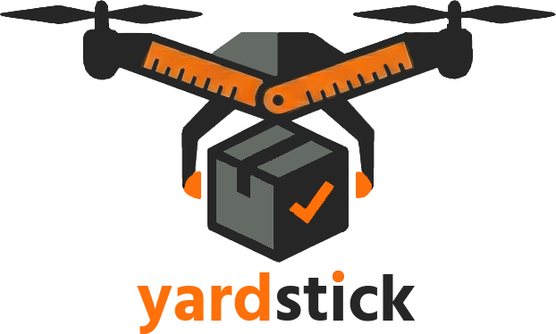

<p align="center">
  <picture>
    <source media="(prefers-color-scheme: dark)" srcset="assets/branding/logo-dark.png">
    
  </picture>
</p>

# Yardstick Development Studio

A desktop IDE, written in Rust with [egui](https://github.com/emilk/egui), for building
[Yardstick](https://github.com/jeffpearson1/Yardstick) recipes. It walks you through
**designing** a recipe, **testing** it with the recipe harness, **creating or fixing it
agentically** with the repo's `yardstick-recipes` skill, and **promoting** it to production.

The Studio never writes to a production Yardstick folder and never runs the harness
there. You work in a development clone and promote finished recipes with
`Publish-Yardstick.ps1`.

## Feature tour

| View | What it does |
|------|--------------|
| **Home** | The guided "design, test, agent, promote" path and the workspace status (production, development or unconfigured). It can clone a development workspace from GitHub, copying the icons that aren't in Git from production, and can launch `Install-Yardstick -DevelopmentOnly` for a fresh clone. It also shows the toolchain environment (pwsh, git, agent CLIs) and the settings. |
| **Recipes** | Library of all shipped and `Recipes\Development` recipes, with filters, location and verdict badges, *New recipe* from templates, and *Copy to Development*. |
| **Designer** | Form-based editor whose field catalogue mirrors Yardstick's schema (`Test-RecipeSchema`) and the skill's guidance. Fields are grouped into steps, script fields get a highlighted PowerShell editor, and it lints as you type. Saving keeps key order and writes scripts as literal blocks. It warns before dropping YAML comments; use the YAML Editor to keep them. |
| **YAML Editor** | Raw YAML with syntax highlighting, kept in sync with the Designer. |
| **Test Bench** | Runs the harness steps: Lint, Schema, Lab (download/package) and Install test (dry run or live). Live install tests need an explicit consent dialog. "Run safe checks" chains Lint, Schema and DryRun. |
| **Agent** | Runs the `yardstick-recipes` skill through GitHub Copilot CLI or Claude Code. Tasks are Create, Fix, Review, Update and Freeform. Output streams live, and the recipes the agent changed are picked up from its `STUDIO-RECIPES:` line. |
| **Batch** | Open a request list (ServiceNow/JSON export, CSV/TSV, Excel `xlsx/xls/ods`, YAML, text/Markdown/email, HTML, Word `docx`) by picker, drag and drop, or `yardstick-studio.exe <file>`. A quick scan pulls out the software, version, vendor URL and ticket for each request, and flags requests that aren't software. *Extract with agent* has the agent re-read the list for better results. Each item is matched to an existing recipe (an Update) or marked New. Pick the items you want and *Run agent on N selected*: the agent runs one item at a time, and each item records its status, recipe and icon. Batches are saved under `%APPDATA%\YardstickStudio\batches` and resume where they left off. *Copy report* gives a Markdown summary. |
| **Icons** | The icon finder, which replaces Yardstick's `Get-YardstickIcon.ps1`. It searches installer resources (EXE/MSI), Wikidata/Commons, Chocolatey, the vendor site (manifest, touch icon, favicon) and image search in parallel, scores each result for relevance and merges duplicates. Results appear as they arrive. Preview the icon on checker/dark/light backgrounds, clean it up (background removal, trim, square, margin), save it to `Icons\` and set `iconFile` in the recipe. Also opens from the Designer (*Find icon…*), from a Batch item, or with `--icons "<app>"`. |
| **Runs** | Browses `Artifacts\RecipeHarness\_install-tests`, parsing `summary.json` into verdicts and phase tables. |
| **Docs** | The skill and its reference docs, rendered as Markdown. |
| **Promote** | Select validated Development recipes and run a `Publish-Yardstick -WhatIf` preview. *Publish…* only unlocks after a successful preview of exactly that selection, followed by a confirmation dialog. |

See [docs/DESIGN.md](docs/DESIGN.md) for the architecture and the safety model.

## Prerequisites

- Windows 10/11 and PowerShell 7 (`pwsh`). Windows PowerShell 5.1 is used as a fallback.
- Rust from [rustup](https://rustup.rs). Either host toolchain works:
  - **x86_64-pc-windows-msvc**: needs the Visual Studio C++ build tools.
  - **x86_64-pc-windows-gnu**: no Visual Studio needed, but it does need MinGW-w64 binutils:
    `winget install BrechtSanders.WinLibs.POSIX.MSVCRT --scope user`.
    `build.ps1` finds it automatically and sets `-C dlltool=`.
- A GPU with DirectX 12 or Vulkan, or the WARP software rasteriser. Rendering uses
  `wgpu`, so it works on VMs and RDP sessions that lack OpenGL 2.
- For the Agent view, at least one of `copilot` (GitHub Copilot CLI) or `claude` (Claude Code) on `PATH`.

## Build and run

`cargo` doesn't need to be on `PATH`, because `build.ps1` adds `%USERPROFILE%\.cargo\bin`:

```powershell
.\build.ps1                 # release build -> target\release\yardstick-studio.exe
.\build.ps1 -Task run       # debug build and launch
.\build.ps1 -Task test      # unit tests (headless engine + GUI helpers)
.\build.ps1 -Task clippy    # lint with -D warnings
.\build.ps1 -Task installer # release build + MSI (see Installer below)
.\build.ps1 -Task build -Debug
```

Command-line shortcuts:

```powershell
yardstick-studio.exe "Exported ticket list.json"   # open a request list in Batch mode
yardstick-studio.exe --batch .\requests.xlsx       # same thing, explicitly
yardstick-studio.exe --icons "Notepad++"           # open the icon finder and search
```

The live integration tests are ignored by default. They run the real harness against a
throwaway development clone and check that production is refused:

```powershell
$env:YSTUDIO_TEST_CLONE = 'C:\Temp\ysclone'          # a git clone of Yardstick
$env:YSTUDIO_TEST_PRODUCTION = 'C:\Intune\Yardstick'  # used read-only, for icons and the refusal check
.\build.ps1 -Task test -CargoArgs '--test','live_harness','--','--ignored','--nocapture','--test-threads=1'
```

> If a build fails with `os error 32 ... being used by another process`, real-time
> antivirus scanning is locking a file in `target\`. Run the build again.

## Installer

```powershell
.\build.ps1 -Task installer   # release build + MSI -> target\installer\YardstickDevelopmentStudio-<version>-x64.msi
```

The installer is a per-machine x64 MSI built with [WiX Toolset](https://wixtoolset.org)
5.0.2, which is MS-RL licensed. WiX 6 and later charge an Open Source Maintenance Fee, so
the version is pinned. The first run downloads WiX, checks its SHA-256, and unpacks it into
`.tools\`. This needs no admin rights and installs nothing system-wide. The executable only
uses DLLs that ship with Windows, so the MSI installs just `yardstick-studio.exe` and
`LICENSE.txt` into `Program Files\Yardstick Development Studio`, plus a Start menu shortcut.

| Task | Command |
| --- | --- |
| Interactive install | Double-click the MSI. It shows the licence, then asks for admin rights. |
| Silent install | `msiexec /i YardstickDevelopmentStudio-<version>-x64.msi /qn` |
| Silent uninstall | `msiexec /x YardstickDevelopmentStudio-<version>-x64.msi /qn` |

To deploy with Intune, add the MSI as a *Line-of-business app* (or wrap it as a Win32
app), install it in the device context, and detect it by its MSI product code. Every
build gets a new product code and shares one UpgradeCode, so installing a newer version
replaces the old one, and installing an older version over a newer one is refused. Bump
`version` in the root `Cargo.toml` for each release; it becomes the MSI version.

Settings in `%APPDATA%\YardstickStudio` are left in place on uninstall. The MSI and
executable aren't code-signed yet, so SmartScreen may warn on first run. Sign both with
`signtool` before distributing widely.

The installer artwork in `installer\*.bmp` comes from `assets\branding`. To regenerate it,
run `python installer\make-art.py`, which needs Pillow.

## Performance

On machines without a GPU, such as VMs and RDP sessions, the Studio automatically uses its
own multithreaded CPU renderer instead of WARP. On the reference VM that takes rendering
from about 1.8 fps to about 100 fps.

| Setting | Effect |
| --- | --- |
| `YSTUDIO_RENDERER=software` or `wgpu` | Forces a renderer. |
| Ctrl+Shift+P | Shows UI-build and paint times in the status bar. |
| `YSTUDIO_PERF_LOG=<file>` | Logs the view, UI ms, timestamp and paint ms for each frame. |
| `YSTUDIO_PERF_CONTINUOUS=1` | Repaints continuously, for benchmarking. |

## First run

1. Launch the Studio. It opens `C:\Intune\Yardstick` read-only, shown by the red
   *Production* badge.
2. On **Home**, choose **Clone development workspace**. If the clone is new, run
   `Install-Yardstick -DevelopmentOnly` from the banner. Settings are stored in
   `%APPDATA%\YardstickStudio\settings.json`, which also holds the production paths and
   trusted development paths.
3. Pick a recipe in **Recipes**, *Copy to Development*, then edit it in **Designer**.
4. In **Test Bench**, run *safe checks*, then run a live install test if you want one.
5. **Promote**: preview, then publish.
